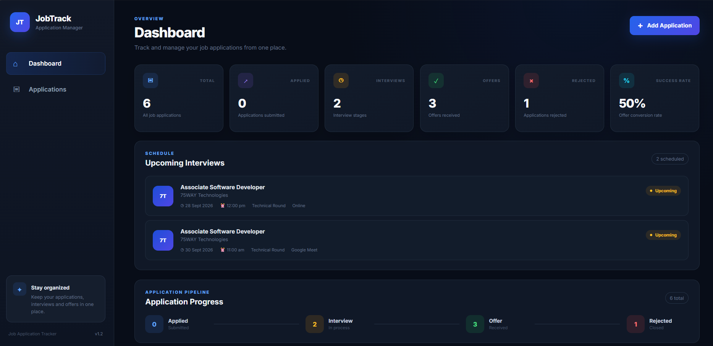
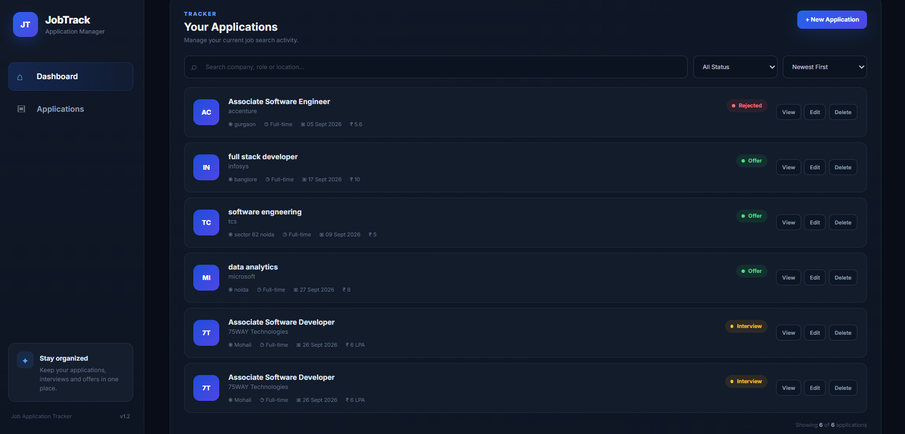
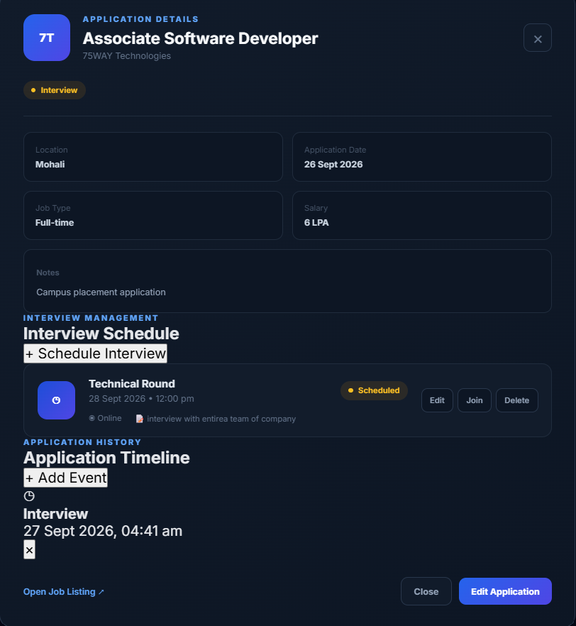
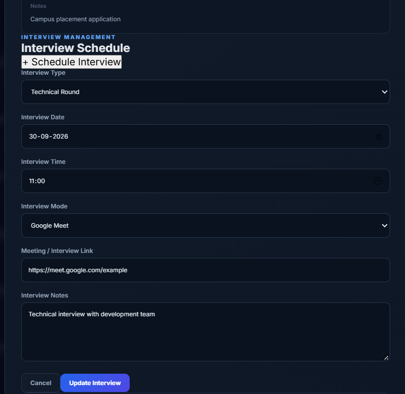

# JobTrack — Job Application Tracker

A full-stack web application designed to help users manage, track, and monitor their job applications, application progress, and interview schedules from one centralized dashboard.

## Project Overview

JobTrack is a personal job application management system.

When a user applies for a job through an external platform such as LinkedIn, Naukri, Indeed, or a company's career portal, they can manually save the application details in JobTrack.

The application can then be tracked through different stages such as:

Applied → Interview → Technical Round → HR Round → Offer / Rejected

The dashboard provides a centralized view of job applications, upcoming interviews, application statistics, and application progress.

---

## Key Features

### Job Application Management

- Add new job applications
- Edit existing applications
- Delete applications
- Track company name
- Track job role
- Track location
- Track application date
- Track job type
- Track salary information
- Store job listing URL
- Add application notes

### Application Status Tracking

Applications can be tracked using different statuses:

- Applied
- Interview
- Offer
- Rejected

Interview-related stages can also be recorded in the application timeline:

- Technical Round
- HR Round

### Application Timeline

Each application can have a detailed timeline containing important events.

Timeline events include:

- Applied
- Interview
- Technical Round
- HR Round
- Offer
- Rejected
- Interview Scheduled

Each timeline event stores:

- Status / stage
- Event date and time
- Optional notes

### Interview Management

JobTrack includes an interview scheduling system.

Users can record:

- Interview type
- Interview date
- Interview time
- Interview mode
- Meeting link
- Interview notes

Supported interview modes include:

- Online
- Google Meet
- Microsoft Teams
- Zoom
- Phone
- In-person

Scheduled interviews are displayed automatically in the "Upcoming Interviews" section of the dashboard.

Users can also:

- Schedule interviews
- Edit interview schedules
- Delete interview schedules
- Open meeting links using the Join button

### Dashboard

The dashboard provides an overview of the user's job search activity.

It displays:

- Total applications
- Applied applications
- Interview stages
- Offers
- Rejected applications
- Offer conversion rate
- Upcoming interviews
- Application progress pipeline

### Search and Filtering

Users can search applications by:

- Company
- Job role
- Location

Applications can also be filtered by:

- All Status
- Applied
- Interview
- Offer
- Rejected

### Sorting

Applications can be sorted by:

- Newest First
- Oldest First

### Responsive UI

The frontend uses a professional dark SaaS-style dashboard interface designed for desktop and responsive layouts.

---

## Technology Stack

### Frontend

- React.js
- JavaScript
- Vite
- HTML5
- CSS3

### Backend

- Python
- FastAPI
- SQLAlchemy
- Pydantic

### Database

- SQLite

### API

- REST API
- HTTP/JSON communication
- Custom FastAPI endpoints

### Development Tools

- Visual Studio Code
- PowerShell
- Git
- GitHub

---

## Frontend Server

The frontend is developed using React.js with Vite.

During development, the Vite development server runs on:

```text
http://localhost:5173
The frontend is responsible for:

User interface
Dashboard
Application forms
Search and filtering
Application cards
Application details
Interview scheduling UI
Timeline UI
Sending API requests to the backend
Displaying backend data
Backend Server

The backend is developed using Python and FastAPI.

During development, the FastAPI server runs on:

http://127.0.0.1:8000

The backend is responsible for:

REST API
Application CRUD operations
Timeline management
Interview management
Database communication
Request validation
Returning JSON responses

FastAPI also provides automatic interactive API documentation at:

http://127.0.0.1:8000/docs
API Communication

The React frontend communicates with the FastAPI backend using HTTP REST API requests.

The communication flow is:

React Frontend
     |
     | HTTP / JSON
     ▼
FastAPI REST API
     |
     ▼
SQLAlchemy ORM
     |
     ▼
SQLite Database

The frontend sends requests such as:

GET
POST
PUT
DELETE

to the backend API.

API Endpoints
Application APIs
Get all applications
GET /api/applications

Returns all stored job applications.

Create application
POST /api/applications

Creates a new job application.

Get single application
GET /api/applications/{application_id}

Returns details of a specific application.

Update application
PUT /api/applications/{application_id}

Updates an existing application.

Delete application
DELETE /api/applications/{application_id}

Deletes an application.

Timeline APIs
Create timeline event
POST /api/applications/{application_id}/timeline

Adds a new timeline event to an application.

Get application timeline
GET /api/applications/{application_id}/timeline

Returns timeline events for an application.

Delete timeline event
DELETE /api/timeline/{timeline_id}

Deletes a timeline event.

Interview APIs
Create interview schedule
POST /api/applications/{application_id}/interview

Creates an interview schedule for an application.

Get application interviews
GET /api/applications/{application_id}/interview

Returns interview schedules for an application.

Get upcoming interviews
GET /api/interviews/upcoming

Returns upcoming interview schedules displayed on the dashboard.

Update interview
PUT /api/interviews/{interview_id}

Updates an interview schedule.

Delete interview
DELETE /api/interviews/{interview_id}

Deletes an interview schedule.

Health Check API
GET /api/health

Used to verify that the backend server is running correctly.

Database

JobTrack currently uses SQLite as its database.

Database file:

backend/job_tracker.db

SQLAlchemy is used as the ORM layer between the FastAPI backend and SQLite database.

The main database entities include:

JobApplication

Stores:

Company
Role
Location
Status
Application date
Job type
Salary
Job URL
Notes
ApplicationTimeline

Stores:

Application ID
Status
Event date
Notes
InterviewSchedule

Stores interview-related information such as:

Application ID
Interview type
Interview date
Interview time
Mode
Meeting link
Notes
Project Architecture
                    JobTrack
                       |
                       ▼
              React.js Frontend
                 Vite Server
              localhost:5173
                       |
                       | REST API
                       | HTTP / JSON
                       ▼
                FastAPI Backend
               127.0.0.1:8000
                       |
                       ▼
                 SQLAlchemy ORM
                       |
                       ▼
                  SQLite DB
             backend/job_tracker.db
Application Workflow
User Applies for Job
        |
        ▼
Applies through LinkedIn / Naukri /
Indeed / Company Career Portal
        |
        ▼
Adds Application to JobTrack
        |
        ▼
Application Status: Applied
        |
        ▼
Interview Call Received
        |
        ▼
Schedule Interview in JobTrack
        |
        ▼
Upcoming Interview appears
on Dashboard
        |
        ▼
Technical Round
        |
        ▼
HR Round
        |
        ├──────────────► Offer
        |
        └──────────────► Rejected
Application Timeline Flow
Applied
   |
   ▼
Interview Scheduled
   |
   ▼
Technical Round
   |
   ▼
HR Round
   |
   ├──────────────► Offer
   |
   └──────────────► Rejected

The timeline allows the user to maintain a history of important application events.

AI / Machine Learning Usage
Current Version

The current version of JobTrack does not use an AI or Machine Learning model.

There is no external AI API or LLM integration in the current application.

The project focuses on:

Full-stack web development
REST API development
CRUD operations
Database management
Application tracking
Interview scheduling
Timeline management
Search and filtering
Dashboard statistics
Future AI Possibilities

AI-based features can be added in future versions, such as:

AI-powered job recommendation
Resume-to-job matching
Job description analysis
Interview question generation
Resume improvement suggestions
Application success analytics
AI interview preparation assistant

These features are considered future enhancements and are not part of the current implementation.

External APIs and Services

The current application does not depend on third-party job-search APIs.

Job listings are not automatically scraped or imported.

Users manually enter the job application information after applying on external job platforms.

The application uses its own custom REST API built with FastAPI.

Main API
FastAPI REST API
http://127.0.0.1:8000
API Documentation
http://127.0.0.1:8000/docs
Project Structure
Job-Application-Tracker/
│
├── .gitignore
│
├── README.md
│
├── screenshots/
│   ├── dashboard.png
│   ├── applications.png
│   ├── application-details.png
│   └── interview-schedule.png
│
├── backend/
│   ├── main.py
│   ├── database.py
│   ├── models.py
│   ├── schemas.py
│   ├── requirements.txt
│   └── job_tracker.db
│
└── frontend/
    ├── src/
    │   ├── App.jsx
    │   ├── index.css
    │   └── ...
    │
    ├── package.json
    ├── package-lock.json
    └── ...

Note: The SQLite database file is used locally during development and is excluded from Git using .gitignore.

Installation and Setup
Prerequisites

Make sure the following are installed:

Python 3
Node.js
npm
Git
Visual Studio Code
Backend Setup

Open a terminal in the project root.

Navigate to the backend:

cd backend

Create a Python virtual environment:

python -m venv venv

Activate the virtual environment:

.\venv\Scripts\Activate.ps1

Install backend dependencies:

pip install -r requirements.txt

Start the FastAPI server:

uvicorn main:app --reload

Backend server:

http://127.0.0.1:8000

API documentation:

http://127.0.0.1:8000/docs
Frontend Setup

Open a second terminal.

Navigate to the frontend:

cd frontend

Install dependencies:

npm install

Start the Vite development server:

npm run dev

Frontend:

http://localhost:5173
Running the Complete Application

Both servers should be running.

Terminal 1 — Backend
cd backend
.\venv\Scripts\Activate.ps1
uvicorn main:app --reload

Backend:

http://127.0.0.1:8000
Terminal 2 — Frontend
cd frontend
npm run dev

Frontend:

http://localhost:5173

Open the frontend URL in a browser to use JobTrack.

## Screenshots

### Dashboard



### Applications



### Application Details



### Interview Schedule



Security and Data Handling

The current version is designed as a local development and portfolio project.

SQLite is used for local data storage.
No user authentication is implemented.
No passwords are stored.
No external job-search account credentials are required.
Job applications are entered manually by the user.
The backend currently allows frontend communication through CORS configuration for development purposes.

For a production deployment, authentication, authorization, secure CORS configuration, environment variables, and a production database would be recommended.

Future Enhancements

Possible future improvements include:

User authentication and registration
Cloud database integration
Email notifications
Google Calendar integration
Interview reminders
Follow-up reminders
Advanced analytics
Application success analytics
Company-wise analytics
Resume version tracking
Resume-to-job matching
AI-powered job recommendations
AI interview preparation
Job priority management
Production deployment
Learning Outcomes

This project demonstrates practical experience with:

Frontend development using React
React state management
Component-based UI development
REST API integration
Backend development using FastAPI
CRUD API development
Request validation using Pydantic
Database modeling using SQLAlchemy
SQLite database management
HTTP and JSON communication
Search and filtering
Dashboard development
Interview scheduling
Timeline management
Git and GitHub version control
Project Purpose

The purpose of JobTrack is to provide a centralized and easy-to-use platform for managing job applications and monitoring the complete application journey.

Instead of maintaining application information across spreadsheets, notes, or multiple places, users can manage their applications, timelines, interviews, and job-search progress from one dashboard.

Author

Rahul Singh

BTech CSE
IILM University

License

This project is developed for educational and portfolio purposes.